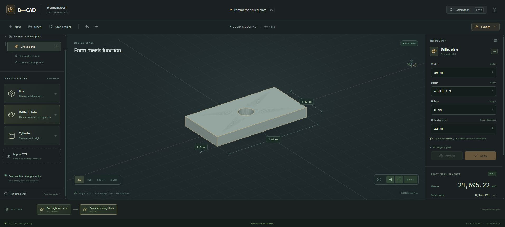

<p align="center">
  
</p>

<p align="center">
  <a href="docs/installation.md"></a>
  <a href="LICENSE"></a>
  <a href="https://github.com/Ramses13th/B-CAD/actions/workflows/docs.yml"></a>
  <a href="CONTRIBUTING.md"></a>
</p>

<h1 align="center">Precision, with room to build.</h1>

<p align="center"><strong>Building an open parametric CAD system inside Blender.</strong><br>
Exact geometry. Editable design intent. A community building in the open.</p>

<p align="center">
  <a href="https://ramses13th.github.io/B-CAD/"><strong>Explore the website ↗</strong></a> ·
  <a href="ROADMAP.md">Roadmap</a> ·
  <a href="docs/architecture.md">Architecture</a> ·
  <a href="CONTRIBUTING.md">Contribute</a> ·
  <a href="https://ramses13th.github.io/B-CAD/search.html">Search docs</a>
</p>

> **Current status: experimental prototype.** The first slice implements exact boxes, drilled plates and cylinders, length expressions, document save/load, undo/redo in a local browser workbench, STEP import/export, STL export and a Blender display adapter. It is a development build, with no production release or full Fusion compatibility. Most of the roadmap is still planned. See [installation](docs/installation.md) and the [experimental decision record](docs/decisions/0002-first-prototype.md).

## Try the first implementation



Create a separate Python 3.13 environment in a checkout, then run the local workbench:

```shell
python -m venv .venv
# Windows:
.venv\Scripts\python -m pip install -r requirements-core.txt
.venv\Scripts\python -m bcad.server
# macOS/Linux commands use .venv/bin/python instead; not yet runtime-tested here.
```

The workbench opens at `http://127.0.0.1:8765`. All geometry is computed locally. Try a drilled plate with `width = 80 mm`, `depth = width / 2`, `height = 8 mm` and `hole_diameter = 12 mm`. Preview a change, apply it, undo it, save a `.bcad` document, or export a STEP body. The interface includes orbit/pan/zoom, standard views, projection controls and a command palette.

For Blender, build the add-on with `python tools/package_addon.py`, install the resulting ZIP, and select the external environment's Python in its preferences. See the [complete installation instructions](docs/installation.md). Native CAD packages stay outside Blender's Python.

## What is B-CAD?

B-CAD aims to bring a Fusion-like mechanical design workflow to Blender: constrained sketches, parameters, a feature history, exact solid geometry, and genuine CAD exchange. Blender would provide the interaction and visualization environment; a separate CAD core would own the engineering model.

The architectural north star is simple: **B-Rep and parameters are authoritative. Blender meshes are display caches.** A tessellated viewport should never quietly become the source of a supposedly exact dimension.

This is an independent community project. It is not affiliated with or endorsed by Autodesk, Blender Foundation, or Open Cascade.

## Start here

| You want to… | Start with… |
| --- | --- |
| Install or try the add-on | [Installation and current availability](docs/installation.md) |
| Find a useful first contribution | [Contributor guide](CONTRIBUTING.md) and [good first issues](https://github.com/Ramses13th/B-CAD/issues?q=is%3Aissue%20is%3Aopen%20label%3A%22good%20first%20issue%22) |
| Bring an AI coding agent | [AI contribution policy](docs/ai-contributions.md), then [AGENTS.md](AGENTS.md) |
| Understand the engineering plan | [Architecture](docs/architecture.md) and [decision record](docs/decisions/0001-cad-architecture.md) |
| Choose a substantial project | [Roadmap and acceptance gates](ROADMAP.md) |
| Edit or preview the docs | [Development guide](docs/development.md) |
| Ask a question | [FAQ](docs/faq.md) or [open an issue](https://github.com/Ramses13th/B-CAD/issues/new/choose) |

## The system we want to build

| Area | Proposed direction | Status |
| --- | --- | --- |
| Sketching | Lines, arcs, circles, dimensions, geometric constraints, degrees of freedom | Planned |
| Exact solids | External CadQuery / OCCT worker; box, drilled plate and cylinder | Experimental slice implemented |
| Parametric history | Versioned document, dependency graph, deterministic recompute, explicit failures | Planned |
| Modeling | Extrude, revolve, Boolean operations, fillet, chamfer, holes, patterns | Planned MVP scope |
| Stable references | Semantic face/edge references with operation history and ambiguity diagnostics | Research priority |
| CAD exchange | STEP base-body import/export and STL mesh export; broader formats/history later | Experimental slice implemented |
| Blender integration | Parameter panel, explicit recompute, `.bcad` save/load, rebuildable display meshes | Experimental adapter |
| Modern interaction | Local browser workbench; broader native tools and shared command schema | First workbench implemented |
| Beyond the MVP | Gears, assemblies, drawings, surfaces, sheet metal, migration, manufacturing bridges | Later roadmap |
| 3D printing | Mesh handoff, FDM/resin preparation, slicing integration and previews | Explicitly deferred, non-priority |

The experimental statuses describe only this small implementation. They do not imply a complete feature history, sketch solver, persistent topology naming or a production CAD system. The [vision and format matrix](docs/vision.md) and [roadmap](ROADMAP.md) distinguish shipped experiments from future capabilities.

## A CAD engine with Blender as its home

```text
Blender interaction + viewport
              ↕ versioned commands / display results
Parametric document + feature dependency graph
              ↕ validated operations / diagnostics
External CAD core → OCCT exact B-Rep
              ↓ tessellation and semantic picking data
Blender display meshes (rebuildable caches)
```

The hard problems deserve early attention: persistent topology references, units and tolerances, transactional undo, solver behavior, reliable native packaging, and failure recovery. The spike uses protocol 1 JSON lines and a schema-versioned JSON document; these are experimental contracts. Solver choice and production storage/protocol/platform decisions remain open. Read the [architecture proposal](docs/architecture.md) and [ADR 0002](docs/decisions/0002-first-prototype.md) before implementing a subsystem.

## Humans and capable AI agents: come build with us

You can contribute as a Blender user, mechanical designer, Python developer, C++/geometry engineer, technical writer, tester, or AI-assisted contributor. Useful work includes concrete design reviews, reproducible CAD cases, accessible UI concepts, documentation, build research, and small, verified patches.

For AI-generated code and architecture, the maintainer's requested quality bar is **GPT-6.1 Sol, Astra, Claude Opus 5.5 level, or equivalent/higher capability**. This is a project contribution requirement, not a measured model ranking. State the model/tool used and provide evidence that the result is understood and verified. Human-only contributions are welcome. All work follows the same review and correctness standards; no AI output merges itself. See the [full AI policy](docs/ai-contributions.md).

1. Read [CONTRIBUTING.md](CONTRIBUTING.md) and choose one bounded task.
2. Check [open issues](https://github.com/Ramses13th/B-CAD/issues) and leave a short plan to avoid duplicate effort.
3. Use a design RFC for kernel, document-schema, solver, or protocol decisions.
4. Open a focused pull request with reasoning, attribution, and verification evidence.

Please share the project with people who can help, star it if you want to follow along, and watch releases when you want to try future builds. Thoughtful, reviewable work is the best way to move the project forward.

## Roadmap at a glance

| Gate | Outcome |
| --- | --- |
| Foundations | Decisions, document/protocol contracts, licensing inventory, reproducible development setup |
| Technical prototype | One constrained sketch → exact extrusion → edit/recompute → STEP round trip |
| Useful MVP | Robust sketching and history, core solid tools, measurement, exchange, installable packages |
| Release hardening | Cross-platform validation, migrations, regression corpus, recovery, accessible documentation |
| Beyond MVP | Assemblies, drawings, broader modeling, migration and manufacturing integrations |

The [full roadmap](ROADMAP.md) contains task IDs, dependencies, acceptance criteria, and release gates. Dates and staffing are intentionally uncommitted.

## Documentation that stays useful

The [public hub](https://ramses13th.github.io/B-CAD/) publishes the Markdown from the main branch, with browser-local search, accessible navigation, a sitemap, and links back to source. Documentation checks validate links and generated pages. A separate prototype workflow exercises documents, the local HTTP boundary and native CAD geometry. See [development and verification](docs/development.md).

## License and acknowledgments

Original repository code and documentation are licensed under **GPL-3.0-or-later**, unless a file says otherwise. See [LICENSE](LICENSE) and [NOTICE](NOTICE). Dependency and distribution choices require an explicit license inventory before native components are shipped.

The project plan was informed by an owner-supplied CAD architecture blueprint and existing work in the Blender and open CAD ecosystem. [Research notes](docs/research.md) distinguish references from decisions and implementation. No third-party CAD source code is bundled in this initial project hub.
