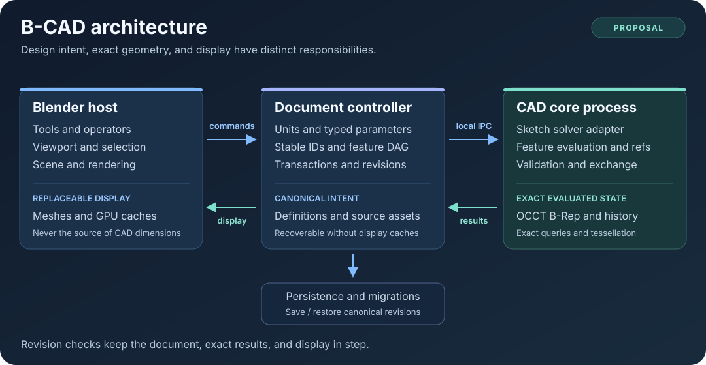

# Architecture proposal

> **Status: proposed target architecture.** The repository now includes a bounded experimental document/controller, isolated CAD worker, local workbench and Blender adapter. [ADR 0002](decisions/0002-first-prototype.md) describes that implementation and its differences from this larger proposal. Code-like examples below explain intended boundaries; they are not stable APIs or implemented-feature claims. The general feature graph, sketch solver and persistent references remain planned.

B-CAD aims to put a parametric mechanical CAD workflow inside Blender while keeping exact geometry and design intent in a dedicated CAD system. The document describes *what should be true* before contributors multiply the feature count. [ADR 0001](decisions/0001-cad-architecture.md) records the proposal and the evidence needed to adopt it. The [roadmap](../ROADMAP.md) turns it into testable work.

## System boundary



Blender tools send edits to a document controller that owns versioned parameters, units, source assets, and the feature DAG. The controller communicates with a separate native CAD core over per-session IPC. The core evaluates exact geometry using OCCT, a sketch-solver adapter, and a reference resolver; revision-tagged results generate Blender's replaceable display caches. Persistence saves and restores the canonical document, including required source assets, rather than depending on display meshes.

The preferred starting point is **Blender as the interaction host, a versioned document as design intent, and an isolated native process using Open CASCADE Technology (OCCT) for exact B-Rep evaluation**. This avoids making an editable triangle mesh the definition of a dimensioned mechanical part. It also gives native dependency packaging and crash recovery an explicit boundary to test.

OCCT provides modeling operations and operation-history facilities; it does not by itself supply B-CAD's complete parametric feature semantics, persistent-selection policy, sketch UX, or undo integration. Its [modeling guide](https://github.com/Open-Cascade-SAS/OCCT/blob/master/dox/user_guides/modeling_algos/modeling_algos.md) is evidence for the available primitives, not proof that our proposed integration is already robust.

## Invariants

| Invariant | Consequence for implementation |
| --- | --- |
| Parameters, feature definitions, imported exact source assets, and document semantics define the model | The canonical document must be sufficient to recover it without tessellation caches |
| Evaluated B-Rep is authoritative for exact geometry queries | Measure/export never silently substitute the Blender display mesh |
| Blender meshes are disposable display/render caches | Deleting or changing tessellation settings cannot change engineering dimensions |
| CAD values have explicit units and precision | Scene display settings are never the only unit definition |
| Persistent identity is semantic | An edge/face array index is not a persistent design reference |
| Every committed CAD edit is a transaction | Undo, save/load, core restart, and visible display agree on one document revision |
| Failure remains visible | Ambiguous references, failed solves, and invalid solids never masquerade as success |
| Mesh/CAD transitions are explicit | Imported mesh, exact imported body, and editable native history have different capabilities |

An important distinction: **the canonical feature document records intent; an evaluated B-Rep records the exact current result**. A cache may accelerate evaluation, but it cannot be the only copy of an imported base body's source data. Required imported geometry must be embedded or referenced through a documented, content-addressed asset mechanism with a missing-asset diagnostic.

## Proposed responsibilities

| Layer | Owns | Must not own |
| --- | --- | --- |
| Blender adapter | Panels, tools, operators, input gestures, viewport overlays, scene integration | Independent CAD truth or hidden native undo history |
| Document/controller | Commands, validation, revisions, dependency graph, persistence, transactions | Kernel-internal shape pointers as public persistent IDs |
| Native core | Kernel evaluation, exact selection/measurement, validation, tessellation, exchange | Unreviewed changes to canonical intent behind the host's back |
| Solver adapter | Translation of sketch entities/constraints and normalized solve diagnostics | A file format whose meaning depends on a solver's internal handles |
| Reference resolver | Feature provenance, topology evolution, ambiguity diagnostics, repair candidates | Guessing a different face because it happens to be nearby |
| Display cache | Meshes, GPU buffers, selection lookup tables, revision tags | Engineering dimensions or source geometry for exact operations |

These are conceptual modules. The language split, directory layout, wire format, and final public API remain open until the foundation spikes are reviewed.

## Canonical document and dependency graph

A proposed document contains units/tolerance policy, named parameters, component definitions, bodies, sketches, datums, features, occurrences, references, and metadata. Assemblies, drawings, and analysis definitions can extend the model later without pretending those systems exist today.

Persistent entities receive UUIDs. The feature dependency graph is a directed acyclic graph (DAG); a conventional body can expose a linear feature tip as a convenient view of that graph. Explicit dependencies permit multi-body workflows and independent branches without forcing every edit through one global ordered list.

Illustrative feature record:

```json
{
  "id": "feature-uuid",
  "type": "Extrude",
  "schema_version": 1,
  "enabled": true,
  "inputs": ["profile-uuid"],
  "parameters": {"distance": "plate_thickness"},
  "operation": "NEW_BODY",
  "dependencies": ["sketch-uuid", "parameter-uuid"]
}
```

The schema should retain feature-specific versions, input identities, source expressions, and unit-aware evaluated quantities. It should validate references and cycles before committing. Unknown future feature types must not disappear during a save; the RFC must define whether such documents open read-only, preserve opaque records, or fail safely.

Evaluation walks dirty descendants in a deterministic topological order. Each result includes feature state, structured diagnostics, output identities, exact-shape provenance, and an evaluation revision. Unaffected branches remain inspectable when another branch fails. Cached last-good geometry may be shown only with a clear stale/failed state; it is not a successful current result.

## Quantities, tolerances, and transforms

The proposal uses double-precision CAD quantities and exact placements in the core. Millimeters as canonical length and radians as canonical angle are candidates, not frozen schema decisions. Unit conversion must occur at declared boundaries and be tested independently of display formatting.

A typed expression parser should support literals with units, named parameters, arithmetic, and a deliberately limited function set. It should reject inconsistent dimensions, cycles, non-finite results, and arbitrary code. A dimension expression is data; it must not use Python `eval()`.

Keep these concepts separate:

| Quantity | Purpose |
| --- | --- |
| Numeric representation | Store and compute CAD values |
| Modeling/coincidence tolerance | Decide geometric validity and coincidence |
| Operation-specific retry policy | Bound any diagnostic healing/fuzzy retry |
| Display tessellation error | Control viewport approximation |
| Export tessellation error | Control manufacturing mesh approximation |
| Display rounding | Format dimensions for people |
| Design clearance | Express a user's physical intent |

A `0.20 mm` design clearance must not silently become the kernel tolerance. Changing display tessellation must not change the exact part.

CAD proxy scale should normally be `(1, 1, 1)`. A drag may show a temporary preview, but committing movement/rotation creates a CAD placement transaction and then drives the proxy from canonical state. Nonuniform scaling and mirroring require explicit supported features or a clear rejection. Parenting and Blender transform operators need a defined integration policy; they cannot silently rewrite mechanical dimensions.

## Native process and protocol

The preferred deployment boundary is a per-Blender-session child service. The endpoint should be local, isolated, randomly identified, authenticated as appropriate, and unavailable to unrelated sessions. Named pipes on Windows and Unix-domain sockets on Unix-like systems are candidates. A fixed shared port is not the default proposal.

Before choosing the transport or encoding, the spike must exercise:

- Protocol/version negotiation, capabilities, document/session IDs, and bounded message sizes.
- Request IDs, document revisions, cancellation, deadlines, and structured error responses.
- Rejection of stale results after edits, undo, document switch, or canceled previews.
- Controlled import paths/assets, schema validation, and untrusted expression handling.
- Progress reporting without blocking Blender interaction.
- Child crash, endpoint cleanup, shutdown, multi-instance isolation, and explicit restart/rebuild.

Only the Blender adapter should touch Blender UI/data through the supported host execution model. Native work and IPC do not grant worker code permission to mutate Blender data arbitrarily. Host integration must be validated against the exact selected Blender version.

The native process should be reproducibly buildable without linking against Blender's embedded Python ABI. That boundary has costs: serialization, lifecycle coordination, packaging, platform builds, and loss of in-process convenience. `FND-06` must measure those costs before adoption.

## Persistent topology references

References are a foundation feature. A face called `faces[17]` today may be a different face after a hole moves or two coplanar faces merge. A UUID attached only to a transient kernel object does not solve that problem either.

An illustrative reference can contain:

```text
TopoRef
  reference UUID
  originating feature UUID
  semantic role, such as extrude side from sketch entity UUID
  source entity/reference UUIDs
  topology evolution provenance
  expected kind and orientation
  diagnostic geometric/adjacency signature
```

The proposed resolver tries semantic generator identity and tracked operation history first, then evaluated OCAF/TNaming support where appropriate. Geometry/adjacency signatures may offer repair candidates; they must not silently approve an ambiguous match. OCCT's [history API](https://www.occt3d.com/dev/doc/refman/html/class_b_rep_tools___history.html) and [OCAF reference-key model](https://occt3d.com/dev/doc/overview/html/occt_user_guides__ocaf.html) provide relevant mechanisms, but B-CAD still needs operation-specific semantics and an edit regression corpus.

No algorithm is promised to make arbitrary topology changes lossless. The acceptance criterion is that supported edits preserve intent and unsupported/ambiguous changes produce a visible, repairable failure. A wrong successful reference is worse than a broken one.

## Sketch solver boundary

Sketch entities and constraints should be stored in project semantics, separate from backend handles. A normalized adapter should expose solve/drag-solve, status, remaining degrees of freedom where available, and conflicting/redundant constraints where available. Unsupported diagnostics need explicit capability reporting.

SolveSpace/libslvs and FreeCAD's PlaneGCS are initial evaluation candidates. SolveSpace documents a [library interface](https://solvespace.github.io/solvespace-web/library.html); FreeCAD's [PlaneGCS source](https://github.com/FreeCAD/FreeCAD/blob/main/src/Mod/Sketcher/App/planegcs/GCS.h) exposes solver machinery. Neither fact selects a winner. The same fixture corpus must compare branch stability, degeneracy, diagnostics, build size, extraction effort, and license obligations. Assemblies should receive a separate rigid-body model rather than inheriting a 2D sketch solver by accident.

## Transactions, persistence, and recovery

A committed edit should follow one path:

1. Validate the proposed command against a known document revision.
2. Create a tentative canonical revision and evaluate its dirty subgraph.
3. Present preview/results and diagnostics without overwriting the committed revision.
4. Commit atomically, or cancel while retaining the previous revision.
5. Tag exact results and display caches with the committed document revision.

Undo/redo restores the canonical document revision through Blender integration and resynchronizes or rebuilds the service from that restored state. The core must not maintain a second independent user-visible undo stack. Cached native results may accelerate resynchronization if their revision identity matches.

The proposed persistence routes are embedded canonical data in `.blend` and a standalone B-CAD container. `.bcad` is a working name, not a specified format. Packaging, attachment handling, canonical serialization, hashes, atomic save, recovery files, migrations, and compatibility promises require their own RFC.

A recovery test must cover save/reopen, deleted caches, interrupted writes, missing imported assets, core crash, malformed files, and a newer unsupported schema. Preserve the original when opening or migrating a document cannot be completed safely. Exact geometry from an imported base feature is required source data, not a disposable cache.

## Geometry validation and exchange

Feature evaluation validates arguments, applies an operation, validates the result, and commits only the supported outcome. Any fuzzy tolerance retry or healing step must be bounded, recorded, and explainable. An exact operation must not silently fall back to a Blender mesh Boolean.

STEP import should initially create an exact non-parametric base feature. Export claims should specify which units, schema, names, colors, and hierarchy were actually verified. OCCT's [XDE guide](https://occt3d.com/dev/doc/overview/html/occt_user_guides__xde.html) describes relevant metadata and assembly mechanisms; it does not guarantee a lossless round trip through every third-party tool.

STL/3MF output is tessellated manufacturing geometry. Expose units and approximation settings, and validate the output with independent readers. CAD Sketcher or other history migration requires a pinned upstream format and an explicit per-element result: editable parametric data, approximation, or mesh reference. A mesh cannot honestly acquire an invented original feature history.

## Verification that earns confidence

Test semantic invariants: document identity, valid solid/body count, critical dimensions, bounding extents, area/volume, analytic geometry where relevant, and reference meaning. Raw BREP bytes are not the primary geometry equality test.

The initial corpus should include a fully constrained rectangle; impossible/redundant constraints; a near-zero line; nested profile holes; tangent/near-coincident Booleans; a changing fillet; split/merged faces; changed pattern counts; a small feature on a large component; mixed units; far-away occurrence placements; and the full undo/save/reopen/core-restart sequence.

Every advertised package needs a clean-install smoke test on its supported host/platform combination. Native dependencies require pinned provenance and redistributable packaging. Compatibility, solver, format, and distribution choices remain open in the [research register](research.md) until evidence and review justify them.
